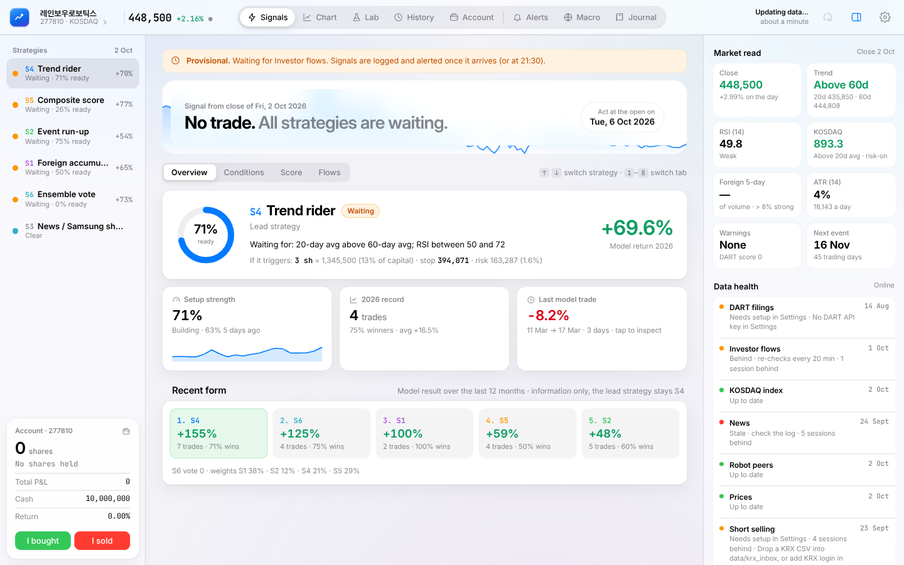
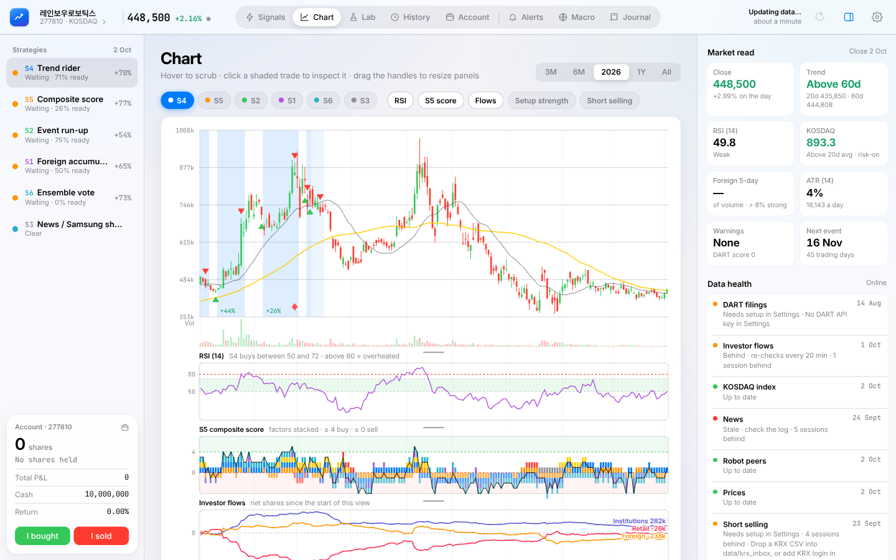
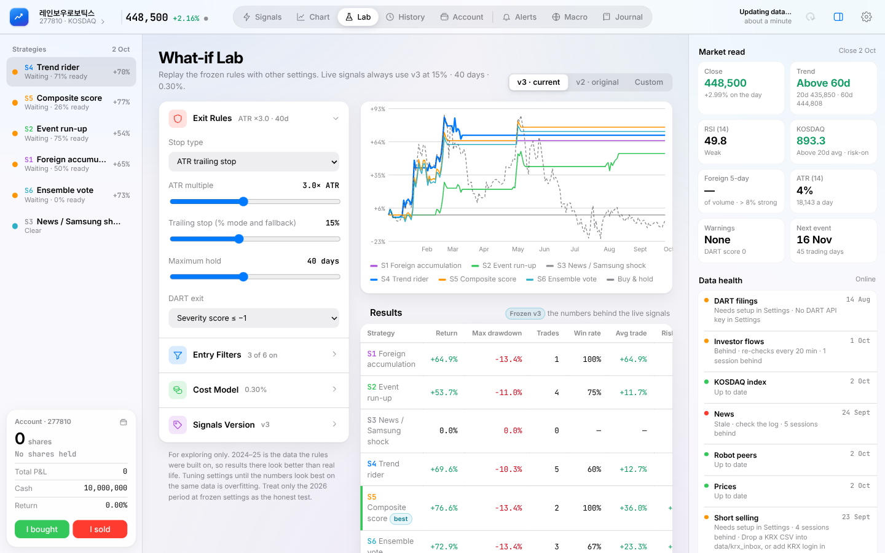
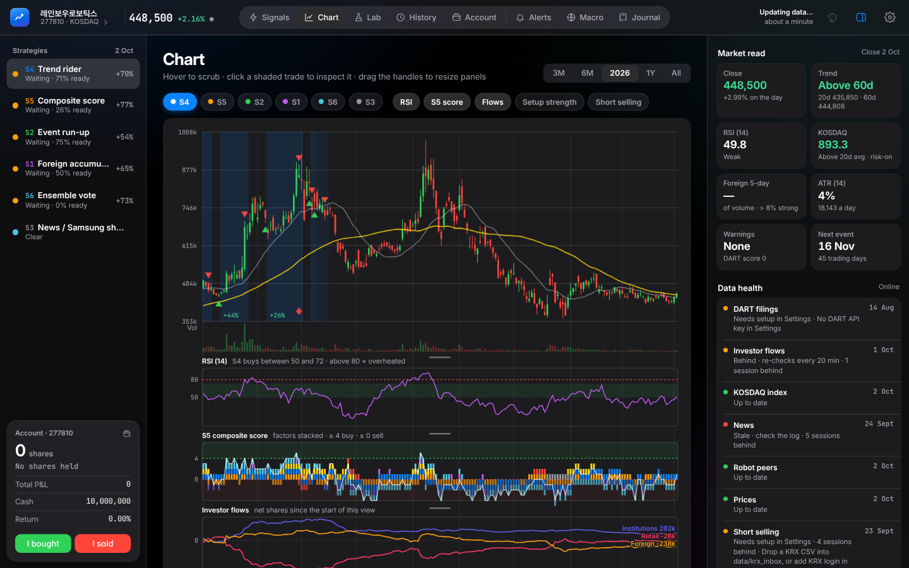

# SwingSignals Desk v4 — Rule-Based Swing-Trading Signal Engine

**[English](#english) · [한국어](#한국어)**



> Personal project (Sep–Oct 2026). Role: product owner, system designer, quant researcher.
> Decision-support tool only: it never places orders and is not investment advice.

---

## English

### What it is
SwingSignals Desk is a local desktop dashboard (Python / Flask / SQLite + a single-page HTML/JS UI) for one stock I trade,
**Rainbow Robotics (277810.KQ)**. After each Korean trading day it updates prices, investor flows, news, filings and
short-selling data, runs six rule-based strategies, and says **BUY / SELL / HOLD / WAIT** and which strategy triggered it.
I place trades at my broker myself and log them in the app's journal.

### Goal
Turn the repeatable triggers behind this stock's big moves into frozen, measurable buy/sell rules, so decisions are made
by logged evidence instead of gut feel or manual chart scanning.

### Hypotheses
| # | Hypothesis | Result |
|---|---|---|
| H1 | Generic textbook setups on ~100 US stocks have an edge, and higher-scored signals win more | **Rejected.** 11-year backtest, 24,602 signals: AUC 0.55–0.62, edge wiped out by costs |
| H2 | One stock's moves are driven by specific observable forces (foreign flows, KOSDAQ trend, Samsung/NVIDIA news, DART filings); rules on those beat buy & hold on unseen data | **Supported so far** (few trades) |

### Results (frozen rules, 2026 out-of-sample, 100% of capital per trade)
| Strategy | 2026 return | Max drawdown | Trades |
|---|---|---|---|
| S4 Trend rider (lead) | **+69.6%** | −10.3% | 5 |
| S5 Composite score | +76.6% | −13.4% | 2 |
| S6 Ensemble vote | +72.9% | −13.4% | 3 |
| S1 Foreign accumulation | +64.9% | −13.4% | 1 |
| S2 Event run-up | +53.7% | −11.0% | 4 |
| Buy & hold | −7.3% | **−57.6%** | — |

S4 stayed in cash through the −57% slide (878k → 373k won, May–Jul 2026). Trade counts are small, so treat the results as directional.

### Features (v4.0)
- Three-panel layout: strategy sidebar + account card, main view, collapsible inspector (market read, data health, DART).
- 8 tabs: **Signals · Chart · Lab · History · Account · Alerts · Macro · Journal** (keyboard 1–8).
- Candlestick chart with strategy trades shaded, RSI / S5 score / investor flows / short panels, day-by-day trade drill-down.
- What-if **Lab**: replay the frozen rules with other stops, holds, costs and rule versions (v2 / v3 / custom).
- Graded "setup strength" (0–100%) per strategy, so you can see a setup building before it fires.
- Alerts (desktop + Telegram), per-trade journal with stars, light/dark mode, Korean price colours.
- Self-healing data updater: 5 scheduled runs a day, 20-minute re-checks of late sources, *Provisional* signals until flows arrive.

### Repository layout
```
app/            engine.py (frozen rules) · server.py (Flask API, scheduler, alerts) · updater.py (data sources) · static/index.html (UI)
data/           price, flows, news, filings, short-selling CSVs the app starts from
research/       strategies.py (2024–25 backtest) · replay.py (2026 walk-forward) · infographic.py · data/ · results/ · figures/
docs/           USER_GUIDE.md (install & usage) · screenshots/
CHANGELOG.md    v3 → v4.0 change history with test results
```

### Run it
```bash
pip install -r requirements.txt
python app/server.py          # opens http://127.0.0.1:8765
```
Windows: `start_windows.bat` · Mac/Linux: `./start_mac_linux.sh`. Full guide: [docs/USER_GUIDE.md](docs/USER_GUIDE.md).
OpenDART key, KRX login and Telegram token are entered in Settings and stored only in local `config.json` (git-ignored).

### Tech stack
Python, pandas, NumPy, matplotlib, scikit-learn (Phase 1), Flask, SQLite, vanilla HTML/CSS/JS ·
Data: Naver Finance, Yahoo Finance, KRX, OpenDART, GDELT, manual event calendar · Built with an AI build agent from my specifications.

---

## 한국어

### 프로젝트 소개
SwingSignals Desk는 제가 직접 매매하는 **레인보우로보틱스(277810.KQ)** 한 종목을 위한 로컬 데스크톱 대시보드입니다
(Python / Flask / SQLite + 단일 페이지 HTML/JS). 매 거래일 장 마감 후 주가, 투자자별 수급, 뉴스, 공시(DART), 공매도 데이터를
갱신하고 6개의 규칙 기반 전략을 계산해 **매수 / 매도 / 보유 / 대기** 신호와 그 신호를 낸 전략을 보여줍니다.
주문은 증권사에서 직접 하고, 앱의 매매일지에 기록합니다.

### 목표
이 종목의 큰 움직임 뒤에 반복되는 트리거를 찾아, 고정되고 측정 가능한 매수/매도 규칙으로 바꾸는 것.
감이나 수동 차트 확인이 아니라 기록된 근거로 판단하기 위함입니다.

### 가설
| # | 가설 | 결과 |
|---|---|---|
| H1 | 미국 주식 ~100종목에 일반적인 기술적 셋업이 우위가 있고, 점수가 높을수록 승률이 높다 | **기각.** 11년 백테스트 24,602개 신호: AUC 0.55–0.62, 거래비용을 넣으면 우위가 사라짐 |
| H2 | 한 종목의 움직임은 외국인 수급, 코스닥 추세, 삼성/엔비디아 뉴스, DART 공시 같은 관찰 가능한 요인이 만든다. 이를 바탕으로 한 규칙은 처음 보는 데이터에서도 바이앤홀드를 이긴다 | **현재까지 지지됨** (거래 수 적음) |

### 결과 (고정 규칙, 2026년 표본 외 검증, 거래당 자본 100%)
| 전략 | 2026 수익률 | 최대 낙폭 | 거래 수 |
|---|---|---|---|
| S4 추세 추종 (메인) | **+69.6%** | −10.3% | 5 |
| S5 종합 점수 | +76.6% | −13.4% | 2 |
| S6 앙상블 투표 | +72.9% | −13.4% | 3 |
| S1 외국인 매집 | +64.9% | −13.4% | 1 |
| S2 이벤트 선행 매수 | +53.7% | −11.0% | 4 |
| 바이앤홀드 | −7.3% | **−57.6%** | — |

S4는 2026년 5–7월 −57% 하락 구간(878k → 373k원) 동안 현금으로 대기했습니다. 거래 수가 적어 방향성 참고용입니다.

### 주요 기능 (v4.0)
- 3단 레이아웃: 전략 사이드바 + 계좌 카드, 메인 화면, 접을 수 있는 인스펙터(시장 요약, 데이터 상태, DART).
- 8개 탭: **신호 · 차트 · 랩 · 기록 · 계좌 · 알림 · 매크로 · 일지** (키보드 1–8).
- 캔들 차트, 전략별 거래 구간 표시, RSI / S5 점수 / 수급 / 공매도 패널, 거래별 일자 상세.
- What-if **랩**: 손절, 보유 기간, 비용, 규칙 버전(v2 / v3 / 사용자 정의)을 바꿔 고정 규칙을 재실행.
- 전략별 "셋업 강도"(0–100%) 표시로 신호가 나오기 전 준비 정도를 확인.
- 알림(데스크톱 + 텔레그램), 별점 매매일지, 라이트/다크 모드, 한국식 색상(빨강 = 상승).
- 자동 복구 데이터 업데이터: 하루 5회 예약 실행, 늦은 데이터는 20분마다 재확인, 수급 확정 전에는 *잠정* 신호.

### 실행 방법
```bash
pip install -r requirements.txt
python app/server.py          # http://127.0.0.1:8765 에서 열림
```
OpenDART 키, KRX 로그인, 텔레그램 토큰은 설정 화면에서 입력하며 로컬 `config.json`에만 저장됩니다(git 제외).

---

## Screenshots
| Chart | What-if Lab | Dark mode |
|---|---|---|
|  |  |  |

## Disclaimer / 면책
Research and decision-support tool, not investment advice. Past performance does not indicate future results.
연구 및 의사결정 보조 도구이며 투자 권유가 아닙니다. 과거 성과는 미래 수익을 보장하지 않습니다.
